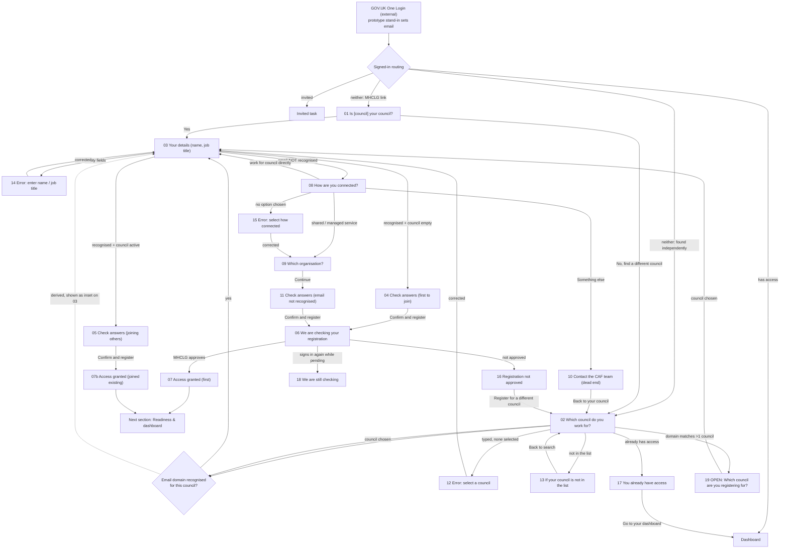

# Claim your council — Stage 1 inventory (no code)

Source of truth: Figma `mnOq3QRhTdiliuSuzQoNsX`, page **209:2382** "03 Claim your council — v3 (Private Beta, gap sweep 25 Sept)".
Blueprint/flow boards: `FbHYoVz1L3eWguCMCg5rH6` node 0:1 (UX Flows) and node 50:1278 (Service blueprint, Stage 3 Claim).
All copy below is quoted verbatim from the frames/content sheets. The README warns all copy is **draft and unapproved**.

## Core rule (from the blueprint)
> NEEDS REVIEW IF the person is the **first** from this council, **or** their email domain **was not recognised**. Otherwise access is granted straight away.
- Joining an already-active council with a recognised email = **instant** (→ 07b).
- First claim on a council = **always reviewed** by MHCLG (→ 06 → 07 / 16 / 18).
- Unrecognised email = reviewed **once, at the end** (→ 06), never twice.
- Confidence tiers (direct = high, shared service = medium-high, managed = medium, manual = provisional) are recorded for MHCLG but **not shown** to the user — the user sees plain language only.
- No agreed review **SLA**, so 06/18 cannot state a time. Approve/reject **email is proposed, not designed**.
- Claiming is **joining, not owning**; it does **not** make you the CAF Lead.

---

## 1. Frame inventory (number, title, node IDs, outgoing links)

| # | Title | Screen | Content | Outgoing links (verbatim trigger → target) |
|---|---|---|---|---|
| — | README | 209:2960 | — | — |
| 01 | confirm-your-council | 209:2383 | 209:2397 | Continue/Yes → 03; "No, find a different council" → 02 |
| 02 | find-your-council | 209:2421 | 209:2433 | Continue → 03; (type, no select) → 12; "not in the list" → 13; (already has access) → 17; (domain matches >1) → 19 |
| 03 | your-details | 209:2460 | 209:2474 | Continue (recognised, first) → 04; (recognised, others) → 05; (empty) → 14; (email not recognised) → 08 |
| 04 | check-answers (first to join) | 209:2504 | 209:2519 | Confirm → 06; Change → 02 / 03 |
| 05 | check-answers (joining others) | 209:2540 | 209:2555 | Confirm → 07b; Change → 02 / 03 |
| 06 | registration-pending | 209:2573 | 209:2584 | (MHCLG approves) → 07; (not approved) → 16; (signs in again) → 18; "Read the guidance" → security.gov.uk |
| 07 | access-granted (first) | 209:2608 | 209:2619 | "Go to your dashboard" → next section (Import if a record exists, else Setup S01) |
| 07b | access-granted (joined existing) | 209:2977 | 209:2988 | "Go to your dashboard" → dashboard |
| 08 | how-are-you-connected | 209:2646 | 209:2661 | directly → 03; shared/managed → 09; "Something else" → 10; (no option) → 15 |
| 09 | which-organisation | 209:2682 | 209:2693 | Continue → 11 |
| 10 | contact-support | 209:2714 | 209:2726 | "Back to your council" → 02 |
| 11 | check-answers (email not recognised) | 209:2747 | 209:2764 | Confirm → 06; Change → 02 / 03 / 08 / 09 |
| 12 | error / find-your-council | 209:2785 | 209:2798 | Continue (corrected) → 03 (error state of 02) |
| 13 | edge / council-not-in-list | 209:2816 | 209:2831 | "Back to search" → 02 |
| 14 | error / your-details | 209:2852 | 209:2867 | Continue (corrected) → 04 (error state of 03) |
| 15 | error / how-are-you-connected | 209:2882 | 209:2898 | Continue (corrected) → 09 (error state of 08) |
| 16 | edge / registration-not-approved | 209:2913 | 209:2927 | "Register for a different council" → 02 |
| 17 | edge / already-have-access | 209:3009 | 209:3021 | "Go to your dashboard" → dashboard; "Register for a different council" → 02 |
| 18 | edge / still-checking | 209:3045 | 209:3056 | "Read the guidance" → security.gov.uk |
| 19 | open / which-council (domain matches >1) | 209:3077 | 209:3093 | Continue → 03 |
| → | Next section: Readiness & dashboard (step 8) | 209:3114 | — | pointer only |

---

## 2. Journey map

Dashed = invisible/automatic step (email-recognition check, access check) shown only as an arrow label in Figma, never its own page.

---

## 3. Per-screen inputs, options, reveals, validation, data captured + session key

Proposed namespace: **`req.session.data.claim`** (plus `claim.oneLoginEmail` set by the stand-in). Full key list in §3b.

**01 confirm-your-council** — caption "Register your council"; H1 "Is Westborough Borough Council your council?"; body "You followed a link for this council. Check it is the right one before you continue."
- Radios (order): 1) "Yes, this is my council" 2) "No, I need to find a different council". No reveal.
- Button "Continue". No validation shown (a "select an option" error is implied but not drawn → flag).
- Captures: confirmation of pre-filled council → `claim.council` (already set from the link), `claim.arrival = "mhclg-link"`.

**02 find-your-council** — H1 "Which council do you work for?"
- Input: label "Council name", hint "Start typing the name, then choose from the list" → accessible autocomplete over the council register.
- Details link: "My council is not in the list" → 13.
- Button "Continue". Validation (frame 12): typed but not chosen → "Select a council from the list".
- Captures: `claim.council = {id, name}`, `claim.arrival = "independent"`.

**03 your-details** — H1 "Your details"
- Inset (recognised): "We recognise [domain] as a [council] email address." (resolved: "We recognise westborough.gov.uk as a Westborough Borough Council email address.")
- Inputs (order): 1) "Full name" (no hint) `autocomplete="name"`; 2) "Job title at this council", hint "For example, Head of IT".
- Body under inputs: "Email address: [email]. You signed in with this address using GOV.UK One Login."
- Button "Continue". Validation (frame 14): both required → "Enter your full name" / "Enter your job title at this council".
- Captures: `claim.person = {fullName, jobTitle}`. `claim.domainRecognised` is derived here (drives → 04/05 vs 08).

**04 check-answers (first to join)** — H1 "Check your answers"
- Summary rows (order): Council → [name] (Change→02); Your name → [name] (Change→03); Job title → [title] (Change→03); Email address → [email] (no Change).
- Inset: "You are the first person from this council to register. MHCLG will check this registration before you get access."
- Button "Confirm and register" → 06. Sets `claim.needsReview = true`, `claim.status = "pending"`.

**05 check-answers (joining others)** — same page/rows as 04.
- Inset: "[number] people from [council] already use this service. You will join them and share the same council record." (resolved: "5 people from Westborough Borough Council…")
- Button "Confirm and register" → 07b. Sets `claim.status = "joined"` (no review).

**06 registration-pending** — Important banner: heading "We are checking your registration", body "You will get an email when MHCLG has checked it."
- H1 "We are checking your registration".
- Body 1: "This is a one-time check because you are the first person from [council] to register. It is not a check on you personally."
- Body 2: "While you wait, you can read the guidance on how the CAF works. You will not be able to see your council record until the check is done."
- Button "Read the guidance" → security.gov.uk. No inputs. (Prototype-only control moves to 07/16/18.)

**07 access-granted (first)** — full-access nav + "Jo Hart · Westborough Borough Council".
- Green panel: title "Registration complete", body "Next, set up your council. The first task is confirming who your council's CAF Lead is. You can also invite colleagues, and see anything MHCLG already holds about your previous CAF assessments."
- H2 "What happens next" + 2 paragraphs (full access; others with recognised email join the same record).
- Button "Go to your dashboard". Sets `claim.status = "approved"`.

**07b access-granted (joined existing)** — full-access nav.
- Green panel: title "Registration complete", body "You have joined Westborough Borough Council".
- H2 "What happens next": "You now share the same council record as the 5 people already working on the CAF here." / "Your registration was not checked by MHCLG because your council is already using the service and we recognised your email address."
- Button "Go to your dashboard".

**08 how-are-you-connected** — H1 "How are you connected to Westborough Borough Council?"
- Body: "We did not recognise [domain] as an email address for this council. That is common, and it does not stop you registering."
- Radios (order): 1) "I work for the council directly" 2) "I work for a shared service or managed service provider that supports the council" 3) "Something else". No reveal.
- Button "Continue". Validation (frame 15): none chosen → "Select how you are connected to this council".
- Captures: `claim.connection` ∈ {direct, shared-managed, something-else}. Routes: 1→03, 2→09, 3→10.

**09 which-organisation** — H1 "Which organisation do you work for?"
- Input: label "Organisation name", hint (screen) "Start typing, then choose from the list, or enter a new name" → accessible autocomplete over the **shared organisation/supplier list** (same list as Setup suppliers).
- Button "Continue" → 11. Captures `claim.organisation`.

**10 contact-support** — H1 "Contact the CAF team"; body "We cannot register you automatically if you are not working for the council or for a service that supports it." / "Email the CAF team at cafsupport@communities.gov.uk. Tell them which council you are registering for and how you are connected to it."
- Button (secondary) "Back to your council" → 02. Dead end by design.

**11 check-answers (email not recognised)** — H1 "Check your answers"
- Summary rows (order): Council → [name] (Change→02); Your name → [name] (Change→03); Job title → [title] (Change→03); Email address → [email] (no Change); How you are connected → [value] (Change→08); Organisation → [name] (Change→09).
- Inset: "MHCLG will check this registration before you get access, because we could not recognise your email address for this council."
- Button "Confirm and register" → 06. Sets `claim.needsReview = true`, `claim.status = "pending"`.

**12 error / find-your-council** — error state of 02. Error summary "There is a problem" → "Select a council from the list"; inline "Error: Select a council from the list"; field shows invalid typed value "Westbro". Page title "Error: Which council do you work for?".

**13 council-not-in-list** — H1 "If your council is not in the list"; intro "There are two reasons a council might be missing. What you do next depends on which one it is."; H2 "Your council has no registered email domain" + "Ask your IT team to contact the domains team so your council email domain can be registered."; H2 "Your domain exists but the council is missing" + "Email the CAF team at cafsupport@communities.gov.uk with your council name and email domain."; button (secondary) "Back to search" → 02.

**14 error / your-details** — error state of 03. Summary links "Enter your full name" / "Enter your job title at this council"; inline "Error: …" above each field; both fields empty. Page title "Error: Your details".

**15 error / how-are-you-connected** — error state of 08. Summary "Select how you are connected to this council"; inline above radios. Page title "Error: How are you connected to this council?" (generic "this council" — see §6).

**16 registration-not-approved** — Important banner "Your registration was not approved" / "MHCLG could not confirm your connection to this council."; H1 "Your registration was not approved"; body "MHCLG could not confirm that [email] is connected to [council]."; H2 "What you can do" + three routes (domain not registered → IT; wrong council → start again; think it's wrong → email cafsupport@communities.gov.uk); button (secondary) "Register for a different council" → 02. **Proposal note**: reason wording and whether a decision can be challenged are open.

**17 already-have-access** — full-access nav. Green Success banner "You already have access" / "There is nothing else to do here."; H1 "You already have access to Westborough Borough Council"; body "You registered on 14 August 2026. You do not need to register again." / "If you need access to a different council as well, you can register for that one separately."; buttons "Go to your dashboard" (primary) + "Register for a different council" (secondary→02).

**18 still-checking** — Important banner "We are still checking your registration" / "You will get an email when MHCLG has checked it."; H1 "We are still checking your registration"; body "You registered for Westborough Borough Council on 21 September 2026. MHCLG has not finished checking it yet." / "You can read the guidance on how the CAF works while you wait. You will not be able to see your council record until the check is done."; button (secondary) "Read the guidance" → security.gov.uk.

**19 OPEN / which-council (domain matches >1)** — caption "Register your council"; H1 "Which council are you registering for?"; body "We recognise [domain] as an email address for more than one council."; radios (order): 1) "Westborough Borough Council" 2) "Eastvale District Council" 3) "Northmoor County Council" 4) "I support all of these councils"; button "Continue" → 03. **Status: NOT AGREED** (see §6).

### 3b. Session data keys (proposed — to be documented in `app/data/claim-session-keys.md`)
`req.session.data.claim = {`
- `oneLoginEmail` — string, set by the One Login stand-in
- `arrival` — "mhclg-link" | "independent"
- `council` — { id, name }
- `domainRecognised` — boolean (derived: email domain ∈ council.recognisedDomains)
- `councilHasUsers` — boolean (derived from example data council state)
- `connection` — "direct" | "shared-managed" | "something-else" (frame 08)
- `organisation` — string (frame 09)
- `person` — { fullName, jobTitle } (frame 03)
- `needsReview` — boolean (derived: !councilHasUsers || !domainRecognised)
- `status` — "pending" | "approved" | "not-approved" | "joined"
- `registeredDate` — string (display on 16/17/18)
`}`
Output read by later sections: `claim.council`, `claim.person`, `claim.status` (Setup reads council name; it does NOT set CAF Lead).

---

## 4. Decision points and what each depends on

| Decision | Where | Depends on |
|---|---|---|
| How did you arrive? | before 01/02 | MHCLG council-specific link (→01, council pre-filled) vs found independently (→02) |
| Is this the right council? | 01 | user confirmation (Yes→03 / No→02) |
| Which council? | 02 | selection from the council register |
| Is the email domain recognised for this council? | automatic, shown on 03 | One Login email domain vs the council's recognised-domains register → recognised path (04/05) vs unrecognised path (08) |
| Does the council already have users? | automatic | council state → first-to-join (04→06, reviewed) vs joining-others (05→07b, instant) |
| Does the domain match more than one council? | 02 | email domain mapped to >1 council → 19 |
| Does this person already have access? | 02 | user already registered for the chosen council → 17 |
| How are you connected? | 08 (unrecognised only) | user choice → direct (03), shared/managed (09), something else (10) |
| Does this claim need MHCLG review? | automatic | needsReview = first-to-join OR not-recognised → 06; else instant → 07b |
| Approved? | MHCLG (not built) | reviewer decision → 07 / 16; prototype-only control simulates it |

---

## 5. Scenarios to reach every frame + example data

Reached via a prototype-only **One Login stand-in** (`/prototype-sign-in`, sets `claim.oneLoginEmail`) and a **scenario switcher** (`/prototype-scenarios`, sets arrival, council state, pending outcome). Example data file: `app/data/claim-example-data.js` labelled "Example data, not real".

Example councils (fictional): **Westborough Borough Council** (`westborough.gov.uk`), **Eastvale District Council** (`eastvale.gov.uk`), **Northmoor County Council** (`northmoor.gov.uk`). Shared-service domain `novatech-services.co.uk` recognised for all three (frame 19). Unrecognised example email `a.mensah@consultancy-cyber.co.uk`. Shared/managed org "NovaTech Managed Services" (shared org list). Each council carries a state: `no-users` or `has-users`.

| Scenario | Email / data | State | Frames reached |
|---|---|---|---|
| A. First to join (recognised) | j.hart@westborough.gov.uk, arrival mhclg-link | Westborough no-users | 01 → 03 → 04 → 06 → 07 |
| B. Joining others (recognised) | j.hart@westborough.gov.uk, arrival independent | Westborough has-users | 02 → 03 → 05 → 07b |
| C. Unrecognised, shared/managed | a.mensah@consultancy-cyber.co.uk | Westborough (any) | 02 → 03 → 08 → 09 → 11 → 06 → 07 |
| D. Unrecognised, something else | a.mensah@consultancy-cyber.co.uk | — | 08 → 10 (dead end) |
| E. Unrecognised, direct | (unrecognised direct email) | — | 08 → 03 → 04/11 → 06 *(see §6 ambiguity)* |
| F. Council not in list | — | — | 02 → 13 |
| G. Already have access | existing-user email | Westborough has-users, already registered | 02 → 17 |
| H. Domain matches >1 | novatech-services.co.uk | 3 councils | 02 → 19 → 03 |
| I. Errors | — | — | 02→12 (type no-select); 03→14 (empty); 08→15 (no option) |
| J. Pending outcomes | first-to-join + prototype control | — | 06 → 07 (approve) / 16 (reject) / 18 (sign in again) |

Prototype-only controls needed: (1) One Login stand-in email; (2) scenario switcher (arrival, council state, which council); (3) approval control to move a pending request to approved / not-approved / still-checking (for 07, 16, 18).

---

## 6. Unclear, missing or contradictory

**Marked OPEN / not agreed in the design**
- **Frame 19 (NOT AGREED):** whether a shared-service person whose domain matches several councils registers **once for all** (current assumption — the "I support all of these councils" option, → 03) or **separately for each**. If "separately", this screen changes or disappears. Also open: how the chosen council(s) are stored, and whether choosing "all" creates multiple claims.
- **No review SLA** (MHCLG): 06 and 18 cannot say how long the check takes.
- **Reason wording + challenge (frame 16, Proposal):** how MHCLG words rejection reasons, and whether a decision can be challenged.
- **Approve/reject email** is promised on 06 but **not designed**.

**Contradictions / mismatches to resolve**
- **"Register" vs "Claim":** every screen's caption is "Register your council" and buttons say "register", but the section/journey is "Claim your council" and the README stresses "joining is not owning". Which term is canonical?
- **Frame 08 journey labels ≠ radio labels:** arrows say "(Works for the council directly)", "(None of these)", "(No option chosen)" while the radios read "I work for the council directly", "Something else". Needs reconciling for correct wiring.
- **Frame 15 page title is generic** ("Error: How are you connected to this council?") while its H1 names the council — conflicts with the project rule "pageTitle must match H1". Apply which?
- **Content-sheet vs rendered-screen copy differs** on several frames (06 banner body + "on how the CAF works"; 07 green-panel body; 09 hint text). The **rendered screen** is newer in each case — build from the screen, not the stale content sheet. Confirm.
- **Frame 04 inset keeps generic "this council"** while 05/06/07b substitute the council name — inconsistent personalisation.
- **"MHCLG" vs "security.gov.uk":** approver is "MHCLG" but the guidance link points to security.gov.uk.
- **Frame 17 journey block is internally inconsistent** (one NEXT line names "Readiness & dashboard" but its parenthetical says it goes back to 02).

**Gaps / not designed**
- **Unrecognised + direct employee path (scenario E):** 08 "directly" routes back to 03, but there is no dedicated check-answers for unrecognised-direct — does it use 04 (first to join) or 11 (email not recognised)? And an unrecognised-direct person joining an **already-active** council should still be reviewed (per the core rule), but 05→07b is instant — no frame covers "unrecognised + council active". Needs a decision.
- **Validation on 01** (select yes/no) and **on 19** (select a council) is not drawn — assume standard GOV.UK required-radio error, or leave unvalidated?
- **Merged/split councils:** NOT DESIGNED (out of scope, blueprint).
- **No revoke-access** path exists once granted (blueprint open) — out of scope here.
- **Domains in example data:** the design uses `.gov.uk`-style fictional domains (westborough.gov.uk); the brief asks for obviously fictional `example.*` domains. Match the design for fidelity, or switch to `example.*`? (Council names like "Westborough Borough Council" are already fictional.)

---

## 6b. Decisions (resolved at Stage 1 sign-off)

1. **Frame 19** — BUILD as a proposal, with the shared "Open question / Proposal" note. Assumes "register once for all matching councils" (the "I support all of these councils" option).
2. **"Claim" not "Register"** — user-directed terminology change applied throughout (a deliberate deviation from the drawn copy, logged). Mapping:
   - caption "Register your council" → **"Claim your council"**
   - "Confirm and register" → **"Confirm and claim"**
   - "Registration complete" → **"Claim complete"**
   - "We are checking your registration" / "We are still checking your registration" → **"...your claim"**
   - "Your registration was not approved" → **"Your claim was not approved"**
   - "Register for a different council" → **"Claim a different council"**
   - body "the first person … to register" → "… to claim"; "register again" → "claim again"; "register for that one separately" → "claim that one separately"
   - Exact before/after strings reported in each batch's text-diff.
3. **pageTitle = H1** everywhere (project rule wins over the design's generic titles). Error pages use "Error: " + H1. Frame 15 title becomes "Error: How are you connected to Westborough Borough Council?" (names the council).
4. **Unrecognised email is ALWAYS reviewed** (closes the gap). Resolution:
   - Recognised + first-to-join → **04** → 06 → 07 (reviewed). Recognised + council active → **05** → **07b** (instant). These two are **recognised-only**.
   - Not recognised → **08**. From 08: "directly" → **11** (check-answers, unrecognised, with **no Organisation row**); "shared/managed" → 09 → **11** (with Organisation row); "something else" → 10. **11 → 06 always.** There is no instant path for an unrecognised email, even if the council is already active.
   - (This routes 08-"directly" to 11 rather than the drawn 08→03 loop — logged as a deviation; rationale: details are already captured on 03, so the person "carries on" to check-answers and the single end-of-journey review, per the blueprint.)
5. SLA, rejection-reason wording/challengeability, and the approve/reject email stay as stated gaps — show the pending page; prototype-only controls simulate the outcome.
6. Build from the **rendered screen** wherever it differs from the content sheet.
7. **Example data domains** — keep the design's fictional `.gov.uk`-style domains (westborough.gov.uk, eastvale.gov.uk, northmoor.gov.uk, novatech-services.co.uk, consultancy-cyber.co.uk) for fidelity to the frames; the council names and domains are clearly fictional, and every data file / prototype control is labelled "Example data, not real".

## 7. Proposed build batches (journey order)

**Batch 0 — prototype scaffolding (not service screens):** One Login stand-in (`/prototype-sign-in`), scenario switcher (`/prototype-scenarios`), example-data file, session-keys doc, shared "Open question / Proposal" partial. *(Built with Batch 1.)*

**Batch 1 — Find your council (4):** 01 confirm-your-council, 02 find-your-council, 12 error find-your-council, 13 council-not-in-list.

**Batch 2 — Your details + recognised check-answers (4):** 03 your-details, 14 error your-details, 04 check-answers (first to join), 05 check-answers (joining others).

**Batch 3 — Review + access (3 + controls):** 06 registration-pending, 07 access-granted (first), 07b access-granted (joined existing) + prototype approval controls (approve / not-approved / still-checking).

**Batch 4 — Unrecognised-email branch (5):** 08 how-are-you-connected, 15 error how-are-you-connected, 09 which-organisation, 10 contact-support, 11 check-answers (email not recognised).

**Batch 5 — Edge + open states (4):** 16 registration-not-approved, 17 already-have-access, 18 still-checking, 19 which-council (OPEN — build only if approved, with the shared "Open question" note).
