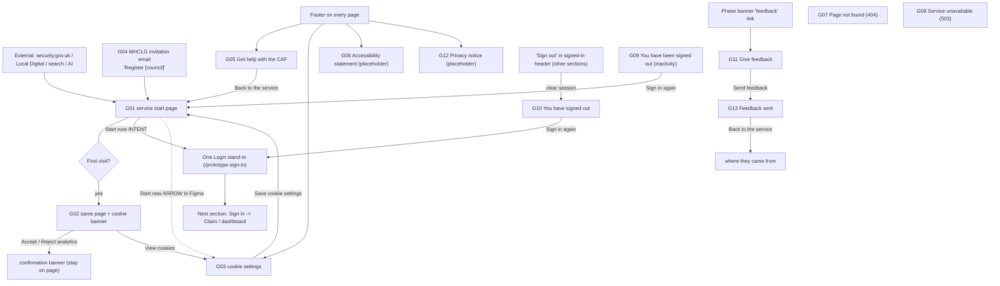

# Get started — Stage 1 inventory (no code)

Source of truth: Figma `mnOq3QRhTdiliuSuzQoNsX`, page **209:1927** "01 Get started — v3 (Private Beta, gap sweep 25 Sept)".
All copy quoted verbatim from the SCREEN frames (the CONTENT frames are abbreviated specs + designer
notes; where they differ it is omission/abbreviation, not contradiction — the SCREEN is authoritative).
README (209:1928) warns: **"All copy is draft and unreviewed by content design."**

## 1. Frame inventory (node IDs exact)

| ID | Title | Screen | Content | Type / links |
|---|---|---|---|---|
| — | README | 209:1928 | — | doc |
| G01 | service-start-page | 209:1943 | 209:1957 | start. In: G02/G03/G05/G09/G04-email. Out: Start now→One Login (intent; arrow→G03), footer, feedback→G11 |
| G02 | service-start-page (first visit, cookie banner) | 209:1980 | 209:1990 | same page as G01 + cookie banner. Banner: Accept/Reject→confirmation; View cookies→G03 |
| G03 | cookie-settings | 209:2004 | 209:2021 | In: G01 (Start now arrow), footer "Cookies", banner "View cookies". Out: Save→G01 |
| G04 | MHCLG invitation | 209:2077 | 209:2088 | **EMAIL**. CTA "Register [council]"→G01 / Claim 01 (pre-selects council) |
| G05 | support | 209:2105 | 209:2121 | footer "Get help with the CAF". Out: Back to the service→G01; links to security.gov.uk + Local Digital (external) |
| G06 | accessibility-statement | 209:2135 | 209:2150 | footer "Accessibility statement". **PLACEHOLDER** |
| G07 | page-not-found | 209:2164 | 209:2174 | **ERROR (404)** — kit default. No action |
| G08 | service-unavailable | 209:2185 | 209:2195 | **ERROR (503)** — prototype route. No action |
| G09 | signed-out (inactivity) | 209:2209 | 209:2219 | **ERROR** — "Sign in again"→G01 |
| G10 | you-have-signed-out (chose) | 212:92 | 212:110 | reached from signed-in header "Sign out". "Sign in again"→One Login |
| G11 | give-feedback | 212:121 | 212:149 | from phase-banner "feedback" link. Out: Send feedback→G13 |
| G12 | privacy-notice | 212:163 | 212:192 | footer "Privacy notice". **PLACEHOLDER** |
| G13 | feedback-sent | 246:3403 | 246:3447 | In: G11. Out: Back to the service→where they came from |
| — | security.gov.uk — CAF for local government | 209:2038 | — | **EXTERNAL** reference card |
| — | Local Digital website | 209:2053 | — | **EXTERNAL** reference card |
| — | Search engines and AI tools | 209:2065 | — | **EXTERNAL** reference card |
| → | Next section: Sign in with GOV.UK One Login | 209:2236 | — | pointer: "Sign in with GOV.UK One Login. Then Claim your council…" |

## 2. Journey map

## 3. Per-screen inputs / options / validation / session key

Most Get started pages are **static content** (no inputs). Interactive ones:

**G02 cookie banner** — buttons in order: "Accept analytics cookies", "Reject analytics cookies" (both green), "View cookies" (link → G03). Choosing accept/reject sets the consent and swaps the banner for a confirmation banner (exact confirmation copy not in the frames — use the GOV.UK standard, flagged). Session: `cookies.analyticsConsent` ("accepted"|"rejected"), `cookies.choiceMade` (true).

**G03 cookie settings** — radio group (one group, 2 options, in order): 1) "Use cookies that measure my website use" (**checked by default**), 2) "Do not use cookies that measure my website use". Save button "Save cookie settings" → G01 with a green success banner ("Your cookie settings were saved"). Session: `cookies.analyticsConsent`. Named tool = **Google Analytics** (placeholder, confirm with Gigo). No analytics actually run.

**G11 give feedback** — fields in order:
1. "Your feedback" — textarea, hint "Do not include personal or security-sensitive information" → `feedback.message`
2. "Email address (optional)" — text input (`type="email"`), hint "If you would like us to reply" → `feedback.email`
Button "Send feedback" → POST → G13. No validation drawn. **No "this does not send" note in the design** — add a prototype-only note (per brief). Nothing is actually sent.

**Sign out** (from the signed-in header in other sections) → clear `req.session.data` → G10.

Full verbatim body copy for every page is in §7 below.

## 4. Shared furniture and its variations

- **GOV.UK header (2025 brand):** crown + "GOV·UK". **Two states:**
  - *Signed-out* (all Get started pages): service name only — "Assess and manage your council's cyber resilience". **No Sign in / Sign out link.**
  - *Signed-in* (Setup/Decide/Claim, already built): full nav + "Sign out" + "Name · Council".
- **Phase banner:** **BETA** + "This is a new service. Your feedback will help us improve it." The "feedback" word links to G11. (Existing `main.html` hardcodes **Alpha** — conflict, see §5.)
- **Footer (every page, in order):** "Get help with the CAF" (→G05), "Cookies" (→G03), "Accessibility statement" (→G06), "Privacy notice" (→G12); licence "All content is available under the Open Government Licence v3.0, except where otherwise stated" + "© Crown copyright".
- **Cookie banner:** shown on **first visit only** (no choice yet), above the phase banner; removed after a choice. Drawn on G02; it is a service-wide element.
- **Back link:** present on service-wide content pages (G05, G06, G03, G12); **absent** on the start page (G01/G02), confirmation (G13), and error/signed-out pages (G07–G10).

## 5. Conflicts with the existing prototype

- **Phase banner:** `layouts/main.html` hardcodes **"Alpha"**; `layouts/setup.html` overrides to **"Beta"**. Get started is **Beta** → make Beta the shared default (and add the "feedback" link in the banner message → G11).
- **Footer link targets:** `setup.html` footer uses `href="#"` for all four links. Get started owns the real targets (Cookies→G03, Accessibility→G06, Privacy→G12, Get help→G05). Wiring them **updates the footer for Setup/Decide/Claim too** (they extend `setup.html`).
- **No cookie banner exists** — new shared element to add service-wide (first visit only).
- **Sign out:** existing "Sign out" links point to `/prototype-scenarios` (Claim) or the holding page. Reconcile to a real sign-out route that clears the session and shows **G10**, without breaking Setup/Decide/Claim.
- **Service-name link:** `main.html` sets `serviceUrl: "/entry"`. The Get started start page is **G01** — the service name should probably link to G01, not `/entry`. (Question.)
- **One Login stand-in already exists:** `/prototype-sign-in` (built for Claim). "Start now" and G10's "Sign in again" should **reuse it**.
- **No signed-out Get started layout** — the start/service-wide pages need the signed-out header variant (service name only). Reuse the res.locals chrome pattern (showNavigation, no currentUser, empty nav).

## 6. Unclear / contradictory / unfinished

**Arrows vs intent**
1. **G01 "Start now":** the Figma prototype link goes to **G03 (cookies)**, but the content note and this brief say it goes to **GOV.UK One Login**. Build Start now → the One Login stand-in; the G03 arrow is a Figma demo artifact. (Confirm.)
2. **G04 email "Register" link:** content note says it pre-selects the council on **Claim 01**; G01's FROM lists it as arriving at **G01**. For this section, wire the email link → G01 (or → the Claim "first-to-join" scenario to demo the pre-selection). (Question.)

**Placeholders / unfinished (do NOT fill in — per brief)**
3. **G06 accessibility statement** — PLACEHOLDER stub ("[To be completed after the accessibility audit…]", "[Standard EHRC wording…]"). Also: the content spec lists **5 required sections**, the rendered screen shows only **3** (missing "technical information" and "what we are doing to improve"). Build the 3 shown; flag the gap.
4. **G12 privacy notice** — PLACEHOLDER; sections "How long we keep it", "Your rights", "Contact" have only bracketed "[To confirm: …]" text. Build structure verbatim; do not fill in.
5. **G01 "roughly 26 weeks"** — placeholder (confirm). **G03 "Google Analytics"** — tool name to confirm (Gigo). **G05 "5 working days"** — placeholder (confirm). Build as shown; flag.
6. **G09 timeout** — the length is undecided, and the GOV.UK **timeout-warning pattern** before sign-out is not drawn (open with Gigo). Build G09 as-is; flag the missing warning.

**Content-frame vs screen omissions** (SCREEN is authoritative): G01 content spec omits the "Before you begin, you may want to read" links; G08 content card omits body paragraph 3; G07 content card is just "Standard GOV.UK 404 wording". No contradictions, only omissions.

**Missing copy**
7. **Cookie confirmation banner** (after Accept/Reject on G02) — not in the frames. Use the GOV.UK standard ("You've accepted/rejected analytics cookies. You can change your cookie settings at any time.") with a Hide link. (Confirm.)
8. **Page `<title>`s** are not in the Figma frames. Set each to match its H1. **"Error:" prefix:** GOV.UK reserves the "Error:" title prefix for form-validation errors, not 404/503/signed-out pages. Your brief says "Error: prefix on error pages" — propose following GDS (no "Error:" on G07/G08/G09, which are not validation errors). (Decision.)

**EXTERNAL links need targets**
9. G01's three "security.gov.uk" guidance links, and G05's security.gov.uk / Local Digital references, need somewhere to go. Propose **one shared labelled placeholder** ("External page, not part of this service") for all external links. Await your decision before building it.

## 6b. Decisions (resolved at Stage 1 sign-off)

1. **G01 "Start now" → the One Login stand-in** (`/prototype-sign-in`). The Figma arrow to G03 is a demo artifact, ignored.
2. **G06 accessibility statement and G12 privacy notice are LEFT OUT for now** (incomplete placeholder legal content). Not built in this section's batches. Their footer links ("Accessibility statement", "Privacy notice") point to the holding page (`/setup/not-in-this-prototype`) until the real content is ready, and are noted as deferred.
3. **One shared external placeholder** page ("External page, not part of this service") is approved, for the security.gov.uk guidance links (G01) and the security.gov.uk / Local Digital references (G05).
4. **No "Error:" title prefix** on G07/G08/G09 (GDS reserves it for form-validation errors; 404/503/signed-out are not). Titles match the H1.
5. **Cookie confirmation banner** uses the GOV.UK standard wording ("You've accepted/rejected analytics cookies. You can change your cookie settings at any time." + a "Hide this message" / change-settings link).
6. **G04 email "Register [council]" link → `/prototype-scenarios/first-to-join`** — the Claim scenario that sets the MHCLG-link arrival with the council pre-selected, landing on Claim 01 ("Is Westborough Borough Council your council?"). This demonstrates the email → registration pre-selection end to end, reusing the already-built Claim journey (the One Login sign-in step is collapsed into the scenario, which sets the recognised email).
7. Placeholders built **as shown and flagged**, not filled: G01 "roughly 26 weeks", G03 "Google Analytics", G05 "5 working days". G09 built as drawn, with the missing GOV.UK timeout-warning pattern flagged.

Batches updated: Batch 2 drops G06 and G12 (now **G05, G11, G13**).

## 7. Verbatim page copy (SCREEN frames)

*(G01, G02, G03, G05, G06, G07, G08, G09, G10, G11, G12, G13, G04-email — full verbatim text captured in the Stage 1 reads; see the per-batch build for the exact strings used. Key placeholders and legal stubs are quoted in §6.)*

## 8. Proposed build batches (shared layout first)

- **Batch 1 — Shared furniture + start/cookies (4):** reconcile the shared layout (Beta phase banner + feedback link, wire footer targets, signed-out Get started chrome, cookie-banner mechanism with a session value) → **G01** service start page, **G02** (same page, first-visit cookie banner + confirmation), **G03** cookie settings.
- **Batch 2 — Service-wide content + feedback (5):** **G05** support, **G06** accessibility statement (stub), **G12** privacy notice (stub), **G11** give feedback (+ prototype-only note), **G13** feedback sent.
- **Batch 3 — Errors + sign-out + email + external (5–6):** **G07** page not found (wire kit 404), **G08** service unavailable (prototype route), **G09** signed out (inactivity), **G10** you have signed out (+ real sign-out route clearing session, reconciled across sections), the **G04** email preview (`/prototype/emails/invitation`), and the shared **external placeholder** (if approved).
