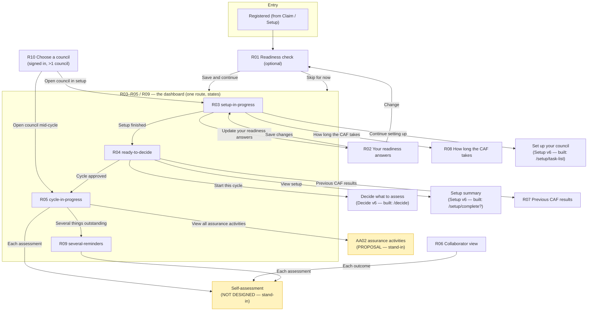

# Readiness and dashboard — Stage 1 inventory (no code)

Source of truth: Figma `mnOq3QRhTdiliuSuzQoNsX`, page **209:56** "05 Readiness and dashboard — v3
(Private Beta, gap sweep 25 Sept)". README: 209:57. All copy quoted verbatim from the SCREEN and
CONTENT frames; the SCREEN is authoritative where they differ. The blue "Journey (generated)" blocks
are routing cross-checks (generated 28 Sept, predating Setup v6 / Decide v6), not screen copy.

## 1. Frame inventory (node IDs exact)

| ID | Title | Screen node | Content node | Type |
|---|---|---|---|---|
| — | README — how this page works | 209:57 | — | doc |
| R01 | readiness / readiness-check | 209:72 | 209:99 | form (optional) |
| R02 | readiness / update-readiness-answers | 209:116 | 209:131 | summary + edit |
| **R03** | dashboard / setup-in-progress | 209:142 | 209:158 | **dashboard state** |
| **R04** | dashboard / ready-to-decide | 209:175 | 209:189 | **dashboard state** |
| **R05** | dashboard / cycle-in-progress | 209:200 | 209:215 | **dashboard state** |
| **R09** | dashboard / several-reminders | 209:313 | 209:330 | **dashboard state** |
| R06 | dashboard / collaborator-view | 209:226 | 209:239 | collaborator home |
| R07 | dashboard / previous-caf-results | 209:253 | 209:269 | content |
| R08 | support / how-long-the-caf-takes | 209:283 | 209:299 | content |
| R10 | edge / choose-a-council | 209:341 | 209:352 | picker |
| — | → Set up your council (link note) | 209:366 | — | note |
| — | → Decide what to assess (link note) | 209:369 | — | note |

R03, R04, R05 and R09 are **one page (the dashboard) in four states**, drawn separately so each can
be reviewed. R06 is the Collaborator's home (deliberately not called a dashboard).

## 2. Journey map

## 3. Per-screen inputs, options, validation, data, proposed session keys

Proposed section session namespace: **`req.session.data.readiness`**. Dashboard state reuses the
existing **`req.session.data.setup`** and **`req.session.data.decide`** (see §5). Multi-council list
reuses the Claim example councils.

### R01 readiness-check (209:72)
- Caption: "Westborough Borough Council" · H1: "Before you start, a few optional questions"
- Intro: "These help us point you at the right guidance. Nothing here is required, and skipping has no consequence."
- Three questions, each radios **Yes / Not yet** (in this order), none pre-selected:
  1. "Do you have a senior sponsor?" → `readiness.seniorSponsor` ("yes"|"notYet")
  2. "Do you know which teams are likely to be involved?" → `readiness.teamsInvolved`
  3. "Do you have a secure way to share evidence with your assurer?" → `readiness.secureEvidence`
- Buttons: **"Save and continue"** (primary) → R03; **"Skip for now"** (secondary) → R03.
- Validation: none (optional; blanks allowed). Also set `readiness.answeredAt` / `readiness.skipped`.
- v3 note (CONTENT): the old "Have you identified who will lead the CAF?" question was **removed**
  (CAF Lead is now a Setup task).

### R02 update-readiness-answers (209:116)
- Back link · Caption "Westborough Borough Council" · H1 "Your readiness answers"
- Intro: "You answered these on 2 September 2026. Update them whenever something changes."
  (CONTENT uses a `[date]` placeholder → render `readiness.answeredAt`.)
- `govuk-summary-list`, three rows, each with a **Change** action → R01 (or per-row edit):
  1. "Senior sponsor" / value / Change
  2. "Teams involved" / value / Change
  3. "Secure way to share evidence" / value / Change
  (Example values as drawn: Not yet / Yes / Not yet.)
- Button: **"Save changes"** → R03.

### Dashboard (one route, states). Caption "Westborough Borough Council", H1 "Your CAF dashboard".
**State selector (proposed):**
| State | Condition |
|---|---|
| R06 collaborator | `currentUser.role === "collaborator"` |
| R03 setup-in-progress | setup not finished (`setup.systemsAllComplete` false / task list incomplete) |
| R04 ready-to-decide | setup finished, no cycle approved (`decide.approval.decision !== "approved"`) |
| R05 cycle-in-progress | cycle approved (`decide.approval.decision === "approved"`) |
| R09 several-reminders | cycle approved + "several outstanding" (prototype flag / early-cycle) |

- **R03 (209:142):** H2 "What to do next" → task-list row "Set up your council", hint "4 of 6 tasks
  done. You only do this once.", tag **IN PROGRESS**; button "Continue setting up" → Setup. H2 "Things
  that might help" → warning-text nudges (see §7 nudge table). H2 "Also on this page" → line
  "People and governance · Previous CAF results · How long the CAF takes · Get help".
- **R04 (209:175):** H2 "What to do next" → task row "Decide what to assess", hint "Choose what this
  cycle covers, then get it approved.", tag **NOT STARTED**; button "Start this cycle" → Decide.
  H2 "Your council record" → summary rows: "Setup" / "Complete, 3 essential services and 4 critical
  systems" / View; "Last assessment" / "Council website and forms, assured March 2025" / View.
- **R05 (209:200):** H2 "This cycle" → three task rows:
  - "Organisation assessment" — "Objectives A and D. 4 of 12 outcomes done." — IN PROGRESS
  - "Northgate Revenues and Benefits" — "Objectives B and C. Not started." — NOT STARTED
  - "Social care case management" — "Objectives B and C. Not started." — NOT STARTED
  H2 "Reminders" → warning text: "Your assurer has not confirmed they can open your evidence
  location." / "Your pre self-assessment call is not booked yet." H2 "Assurance activities" → body
  "Calls and workshops with your assurer, booked through Microsoft Bookings." + summary rows
  "Next" / "Pre self-assessment call · not booked yet" and "Done" / "Onboarding calls for both
  assessments"; link "View all assurance activities" → AA02 stand-in.
- **R09 (209:313):** H2 "This cycle" → one task row "Organisation assessment" — "Objectives A and D.
  Not started." — NOT STARTED. H2 "Reminders" → five warning-text items (verbatim):
  1. "MHCLG has not assigned your assurer yet. We will tell you when they do."
  2. "Your onboarding calls are not booked yet, one for each assessment type."
  3. "Timing for the organisation assessment is still to be confirmed."
  4. "Your assurer has not confirmed they can open your evidence location."
  5. "Your pre self-assessment call is not booked yet."
  Closing body: "None of these stop you starting your self-assessment."

### R06 collaborator-view (209:226)
- Nav variant **collaborator**: "Your tasks" (active) + "Sign out"; user "Priya Shah · Westborough
  Borough Council". Caption "Westborough Borough Council" · H1 "Your tasks"
- Body: "Jo Hart has asked you to work on these outcomes." (CONTENT: "[Inviter] has asked you…")
- Task rows: "A3. Asset management" (Organisation assessment. Not started. NOT STARTED);
  "A4. Supply chain" (Organisation assessment. In progress. IN PROGRESS) → self-assessment stand-in.
- H2 "Need something else?" · body "You can only see the outcomes assigned to you. Ask Jo Hart if you
  need access to more."

### R07 previous-caf-results (209:253)
- Back link · Caption · H1 "Previous CAF results"
- Inset text: "Council website and forms, assured March 2025 against CAF version 3.2. These are held
  for reference only. They are never used to fill in a new assessment."
- H2 "Assured March 2024, against CAF v3.2" **(⚠ contradicts the inset's "March 2025" — see §7)**
- Summary list (key / value, no actions): "B2. Identity and access control" / "Achieved";
  "B4. System security" / "Partially achieved"; "B5. Resilient networks and systems" / "Not achieved";
  "C1. Security monitoring" / "Partially achieved".
- Body (link): "Something look wrong? Tell MHCLG and they will check it."
- Example data — label "Example data, not real" in a prototype note.

### R08 how-long-the-caf-takes (209:283)
- Back link · Caption · H1 "How long the CAF takes"
- Intro: "A full cycle takes most councils around 26 weeks, including assurance. Roughly how that splits:"
- Summary list (key → value) — durations verbatim (PLACEHOLDERS, see §7):
  - "Set up your council" → "Once only, then reused every cycle"
  - "Decide what to assess" → "1 to 2 weeks, including approval"
  - "Prepare" → "1 to 2 weeks"
  - "Self-assessment" → "8 to 12 weeks, the largest part"
  - "Assurance and workshops" → "6 to 8 weeks"
  - "Improvement plan" → "2 to 4 weeks after the report"

### R10 choose-a-council (209:341)
- Nav variant **signed in, no council**: only "Sign out"; no council identity line.
- H1 "Which council do you want to work on?" · Body "You have access to more than one council."
- Summary list (key / value / action) — all actions "Open":
  - "Westborough Borough Council" / "Cycle in progress · 4 of 12 outcomes done" / Open → R05
  - "Eastvale District Council" / "Setup in progress" / Open → R03
  - "Northmoor County Council" / "No cycle started" / Open → R03/R04
- Data: selected council → `readiness.selectedCouncil` (or reuse a council-context key); reuse the
  Claim example councils (Westborough/Eastvale/Northmoor already exist in `claim-example-data.js`).
- Journey block names two outcomes ("Open" → R05, "Council chosen" → R03); the screen shows only
  "Open", which opens that council's dashboard **in its current state**.

## 4. Shared furniture and its variations

Header/footer/phase banner are already shared (`main.html` + `setup.html`): GOV.UK header, the Beta
phase banner with the "feedback" link, the service-wide cookie banner, and the footer with support
links. The Readiness screens use the same furniture. **Three service-navigation variants:**

| Variant (Figma instance) | Used on | Items | Identity line |
|---|---|---|---|
| Service navigation / **full access** | R01–R05, R07–R09 | Dashboard (active), Your council, Assessments, People, Switch council, Sign out | "Jo Hart · Westborough Borough Council" |
| Service navigation / **collaborator** | R06 | Your tasks (active), Sign out | "Priya Shah · Westborough Borough Council" |
| Service navigation / **signed in, no council** | R10 | Sign out | (none) |

Phase banner "BETA" (blue) + "This is a new service. Your feedback will help us improve it." on every
screen. Footer: "Get help with the CAF", "Cookies", "Accessibility statement", "Privacy notice" + OGL
line + © Crown copyright. Back link on R02, R07, R08.

## 5. Conflicts with the existing prototype

1. **No single shared signed-in chrome helper.** Each built section sets its own `res.locals`
   (`applySetupChrome`, `applyDecideChrome`, `applyClaimChrome`/`applyClaimGrantedChrome`). The header
   *markup* is shared (`main.html` `govukServiceNavigation`) — so I will add an `applyDashboardChrome`
   that sets the same locals, **not a second header**. Reuse:
   - **full access** ≈ existing Setup/Decide/Claim-granted nav (Dashboard, Your council, Assessments,
     People, Switch council, Sign out + "Jo Hart · Westborough") — an exact match. Reuse.
   - **signed in, no council** ≈ existing `applyClaimChrome` (Sign out only, no identity). Reuse/adapt.
   - **collaborator** — NEW. Does not exist yet.
2. **"Dashboard" nav item currently points to the holding page** (`/setup/not-in-this-prototype`) in
   Setup/Decide/Claim. The Readiness dashboard becomes its real target (`/dashboard`). This wires the
   sections together (improvement), and "Switch council" → `/choose-council`, "Sign out" →
   `/get-started/sign-out` (the route built in Get started). Needs your OK to repoint these.
3. **Dashboard state must read Setup/Decide session keys.** Available today:
   - `setup` (services/systems, `systemsAllComplete`) → drives R03 vs R04.
   - `decide.approval.decision === "approved"` → drives R04 vs R05. `decide.cycle.selectedSystems`,
     `decide.cniAnswer`, `decide.bookings` (undefined in the current seed) feed R05/R09 content.
   No `readiness` key exists yet → new. No `/dashboard` route exists yet → free to use.
4. **Example-data mismatches** (design vs built seed):
   - R04 says "**4** critical systems"; the built Setup seed has **5** (Northgate, Social care,
     Council website and forms, Housing management system, Urban traffic control). R04's "3 essential
     services" **matches**.
   - R05 task rows **match** the built Decide seed (Organisation assessment + Northgate + Social care).
   - R10 councils **match** `claim-example-data.js` (Westborough/Eastvale/Northmoor).
   - R04/R07 "Last assessment: Council website and forms, March 2025" references a real seed system
     name, but is **historical example data** (the seed doesn't record a prior assurance).
   Decision needed: should the dashboard read **live** Setup/Decide state (numbers will differ from
   the design, e.g. 5 systems), or reproduce the **drawn example** values as a labelled static block?
5. **Scenario switcher exists** (`/beta` index with `/beta/go/:scene` reseed; Claim's
   `/prototype-scenarios`; `/research-rounds`). I will add a Readiness section to `/beta` and a
   prototype-only state switcher on `/dashboard` (reusing the pattern), per the brief.
6. **Two "dashboard"s exist in the old Alpha journey** (`/assessments/current/dashboard`, `/entry`).
   These are the separate Alpha journey — untouched. The new Beta dashboard is `/dashboard`.

## 6. Links-out table (Setup v6 / Decide v6 mapping)

Setup v6 (page 393:2) and Decide v6 (page 393:2311) are **built** in the prototype → link to the
built routes. Journey-block targets name superseded v4/v5 screens.

| Readiness link | Journey block says | Built target (Setup v6 / Decide v6) | Confidence |
|---|---|---|---|
| R03 "Set up your council" / "Continue setting up" | "Set up your council → S01 (Setup v5)" | **`/setup/task-list`** (S01 task list) | High |
| R03 "How long the CAF takes" | "→ R08" | `/dashboard/how-long` (R08, this section) | High |
| R03 "Update your readiness answers" | "→ R02" | `/readiness/answers` (R02) | High |
| R04 "Decide what to assess" / "Start this cycle" | "Decide → D23 if CNI not answered, else D02 (Decide v4)" | **`/decide`** — the built entry routes to the CNI gate `/decide/cni` if CNI unanswered, else onward. **Replaces the D23/D02 branch.** | Medium — confirm the v6 CNI branch (see §7) |
| R04 "View" (Setup record) | "View setup → S30 (Setup v5)" | **`/setup/complete`** (setup summary) — best guess for the v6 "view your setup" equivalent | **Low — confirm** |
| R04 "Previous CAF results" | "→ R07" | `/dashboard/previous-results` (R07) | High |
| R05 "View all assurance activities" | "→ AA02 (Assurance activities page)" | **Stand-in** "Prototype only: assurance activities proposal" (not built) | n/a |
| R05 / R06 / R09 assessment & outcome rows | "the self-assessment: NOT CURRENT" | **Stand-in** "Prototype only: the self-assessment has not been designed yet" | n/a |

Links to the self-assessment stand-in: **R05** (3 task rows), **R06** (2 outcome rows), **R09**
(1 task row). Link to the AA02 stand-in: **R05** ("View all assurance activities").

## 7. Unclear, missing, contradictory

1. **Nudge wording gap (must resolve before building R03).** The brief forbids writing nudges. The
   Content frames give nudge wording for only **2 of the 3** readiness questions (the two drawn as
   "Not yet"):
   | Question | "Not yet" nudge wording available? |
   |---|---|
   | Senior sponsor | **Yes** — "You said you do not have a senior sponsor yet. Making the case to your leadership team may help." |
   | Secure way to share evidence | **Yes** — "You said you do not have a secure way to share evidence yet. You will need one before assurance starts." |
   | Teams involved | **NO nudge drawn** (the example answers it "Yes") |
   → If "teams involved" = Not yet, there is **no nudge wording**. Please supply it, or confirm that
   question produces no nudge. I will not write one.
2. **R07 internal date contradiction:** inset says "assured March 2025", H2 says "Assured March 2024".
   The README and R04 say March 2025. Which is correct?
3. **R06 "NOT STARTED" tag is drawn blue** (GDS default for not-started is grey). Follow GDS (grey) and
   list as a deviation, or match the design (blue)? (All status tags on R03–R05/R09 are blue too.)
4. **R09 shows a single task row** ("Organisation assessment"), where R05 shows three. Is R09 a
   genuinely different council state (nothing set up beyond the org assessment), or a simplification?
5. **Example data: live vs drawn** (see §5.4) — the key decision for the dashboard build.
6. **README open questions** (all PROPOSALS, not agreed): dashboard leading with "whatever comes next"
   (R03–R05); who is offered the readiness check and when (R02, "offered once to whoever first gets
   full access"); R07 alongside vs separate, and CAF-version mapping; R08 durations need MHCLG sign-off;
   R09 five-reminders-reads-as-failure; R10 register-once-vs-per-council (same open question as Claim 19).
7. **"TO CLARIFY WITH ROSA"** (README): review-and-update is out of scope for MVP, so a returning
   council that has already done its organisation assessment cannot redo it and can only assess
   critical systems it has never assessed; many of the 87 returning councils gain little, and some
   reach "nothing new to assess" (Decide D20). **No behaviour to build here** — flagged so you confirm
   how it is handled in Decide.
8. **Index page (page 00) may still list "Q1 CAF lead"** for this section. The v3 screens **removed**
   the CAF Lead question (now a Setup task). The v3 page wins — I will build without it. Mismatch noted.
9. **Microsoft Bookings is a PROPOSAL** — R05's assurance-activities summary and the reminders on
   R05/R09 are built as if agreed. I will add a prototype-only "Proposal" note wherever a Content frame
   marks something PROPOSED/OPEN, outside the service content.
10. **Placeholders (reproduce as drawn, do not correct):** "roughly 26 weeks" (and the R04/R05
    context), and every R08 duration.
11. **R10 "Open" vs the Journey block's "Open"/"Council chosen".** The screen shows only "Open"; the
    Journey block splits into "Open" (→R05) and "Council chosen" (→R03). I will treat "Open" as
    "open that council's dashboard in its current state". Confirm.

## 7b. Decisions resolved (sign-off)

1. **Nudge gap:** "teams involved = Not yet" produces **no nudge** (no drawn wording; not invented).
   Only senior sponsor and secure evidence nudge. Flagged as a content gap to fill later.
2. **Dashboard reads LIVE state** from `setup`/`decide`. Counts (services/systems, tasks done, cycle)
   are computed, so they may differ from the drawn example (e.g. 5 systems not 4). The historical
   "Last assessment" (R04) and "Previous CAF results" (R07) are **example data** (labelled "Example
   data, not real"), since the seed records no prior assurance.
3. **R07 date = March 2025** throughout (matches the inset, README and R04; the H2 "2024" was the
   outlier and is corrected).
4. **Status tags follow GDS**: "Not started" = grey, "In progress" = blue. (Design drew all blue →
   deviation list.)
5. **R04 "View setup" → `/setup/complete`; R04 "Start this cycle" → `/decide`** (the built route
   handles the CNI gate).
6. **Repoint shared nav**: "Dashboard" → `/dashboard`, "Switch council" → `/choose-council`,
   "Sign out" → `/get-started/sign-out` (already wired).

## 8. Proposed build batches (readiness + shared state first)

- **Batch 1 — Readiness check + dashboard shell/state (R01, R02, R03):** build the `readiness` session
  model and the `/dashboard` route with the state selector + prototype state switcher, the three nav
  variants (reusing existing chrome, adding collaborator), then R01, R02 and the **R03** state
  (nudges pending your answer on item §7.1). Wire the Beta index + `/dashboard` switcher.
- **Batch 2 — Core dashboard states (R04, R05, R09):** the "ready to decide", "cycle in progress" and
  "several reminders" states, the self-assessment and AA02 stand-ins, and the links out to Setup/Decide
  (pending the §6 confirmations). Proposal notes on R05/R09.
- **Batch 3 — Other views and edges (R06, R07, R08, R10):** collaborator view, previous results,
  how-long, choose-a-council (multi-council), with their nav variants and example-data notes.

Stage 3 after: pa11y across all screens/states, full route walk, cross-section chrome check,
deviations + proposals + placeholders + the open decisions.
